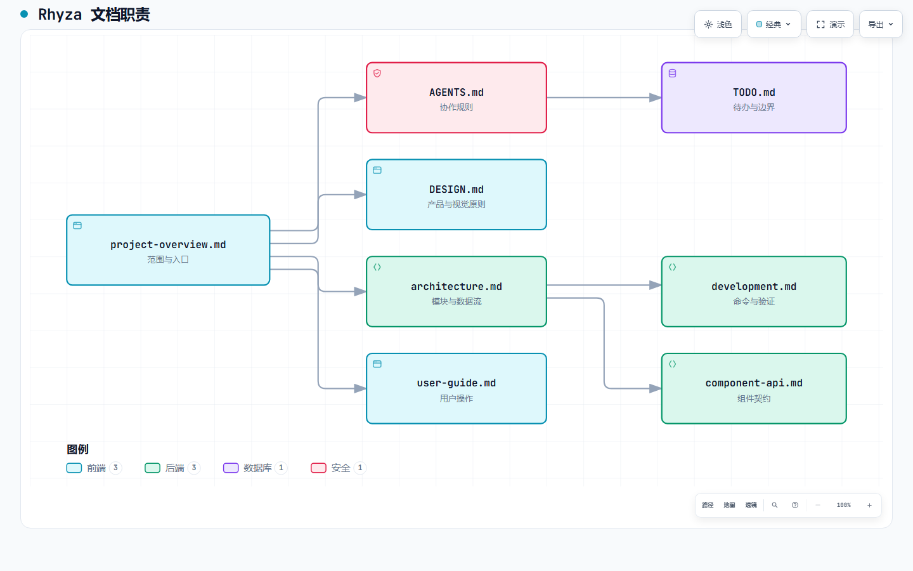

# Rhyza 文档

根目录 [README](../README.md) 说明产品和快速开始；根目录 [AGENTS.md](../AGENTS.md) 规定协作与格式化约束。其余文档按“项目范围 → 设计/架构 → 实施/使用”分工，避免在多个文件中维护同一份事实。

[图表规格](diagrams/docs-map.architecture.json)可用于在本地用 Archify 重新生成文档地图。

## 阅读路径

| 文件 | 负责回答的问题 |
| --- | --- |
| [AGENTS.md](../AGENTS.md) | Agent 和贡献者进入仓库前必须遵守什么？ |
| [DESIGN.md](DESIGN.md) | 产品视觉及交互遵循哪些原则？ |
| [TODO.md](TODO.md) | 当前有哪些经确认但未完成的方向？ |
| [project-overview.md](project-overview.md) | 项目的范围、能力入口与边界是什么？ |
| [architecture.md](architecture.md) | 模块、进程和数据如何连接？[Archify 运行时图](diagrams/rhyza-runtime.png) |
| [user-guide.md](user-guide.md) | 用户如何配置与完成日常操作？ |
| [development.md](development.md) | 贡献者如何启动、修改与验证？ |
| [component-api.md](component-api.md) | 组件与跨进程接口如何约束调用方？ |

## 专题与详解

- [features.md](features.md) 是功能状态和已知限制的事实来源，不把 Planned 当作已交付。
- [development-guide.md](development-guide.md) 保留 Provider、持久化、命令和安全边界的详细参考；`development.md` 是日常入口。
- [product-memory-and-design-principles.md](product-memory-and-design-principles.md) 保留长期产品语义；`DESIGN.md` 是视觉与交互入口。
- [TODO-pi-sdk.md](TODO-pi-sdk.md) 是 Pi SDK 专项任务与验收说明；`TODO.md` 只索引经确认的方向。
- [performance-diagnostics.md](performance-diagnostics.md)、[html-previews.md](html-previews.md)、[媒体素材说明](images/README.md) 分别负责诊断、扩展协议与截图约定。

## 维护约定

1. UI 路径使用 **Page → Section → Action** 表示，并与界面英文文案保持一致。
2. 命令以仓库 `package.json` 为准；删除或重命名 script 时同步更新 `development.md` 和开发指南详解。
3. 功能状态变化时先更新 `features.md`，再按需更新 README 和使用指南。
4. 截图只使用演示 Workspace，不出现真实账号、Token、私有仓库、本地用户名或绝对路径。
5. 演示数据截图标明来源；图片链接只指向已提交文件。待补素材在媒体说明中记录，不用占位图冒充产品界面。
6. 架构图提交 JSON 规格与经检查的 PNG；交互式 HTML 可在本地用 Archify CLI 生成，不提交到仓库。

## 产品设计材料

[Rhyza Product Design v0.3](../Rhyza_Product_Design_v0.3.docx) 保留产品设计背景。判断当前能力时，以[功能与限制](features.md)及代码为准，设计稿不等于已实现功能。
