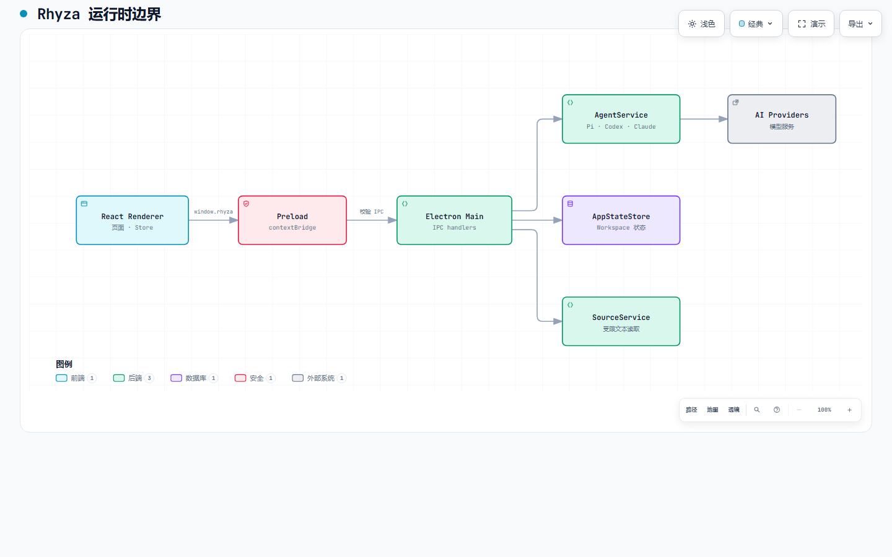

# 架构与数据流

[文档地图](README.md) · [开发流程](development.md) · [组件接口](component-api.md)

[图表规格](diagrams/rhyza-runtime.architecture.json)可用于在本地用 Archify 重新生成交互图。图中只展示主边界；完整服务及存储路径见[开发指南详解](development-guide.md#3-架构)。

## 模块职责

| 边界 | 入口 | 职责 |
| --- | --- | --- |
| Renderer | `src/App.tsx`、`src/pages/`、`src/store/` | HashRouter、页面、会话/知识 UI 和状态；不直接访问 Node 文件系统 |
| Preload | `electron/preload.cjs` | 向沙箱 Renderer 暴露白名单 `window.rhyza` |
| 共享契约 | `src/shared/ipc.ts` | IPC channel、参数类型和运行时校验 |
| Main | `electron/main/` | 验证调用来源、路由 Provider、访问本地文件及持久化 |
| 可选扩展 | `extensions/pi-archify/` | 独立 Pi package，通过通用 HTML Preview 协议交付图表 |

## 两条关键路径

**请求路径**：Renderer 经 `window.rhyza` 调用 preload 暴露的方法；Main 验证 payload 与 sender 后，由 AgentService/PiService 或其他服务执行，再通过事件和结果更新 Store。Provider 认证材料不进入 Renderer。

**持久化路径**：Store 经 preload 请求 Main 的 AppStateStore；按规范化 Workspace 路径隔离状态。Source Catalog、Worktree 和诊断文件使用独立的本地存储路径。读 Source 必须满足清单、相对路径及范围约束。

修改 IPC 时按[开发指南详解的核对清单](development-guide.md#preload-与-ipc)同步共享契约、preload、Main、调用方和测试；修改页面只改变 Renderer，不得绕过 bridge。
